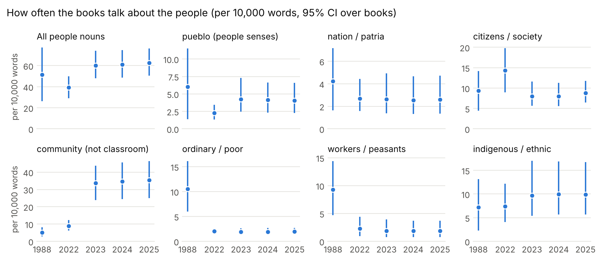
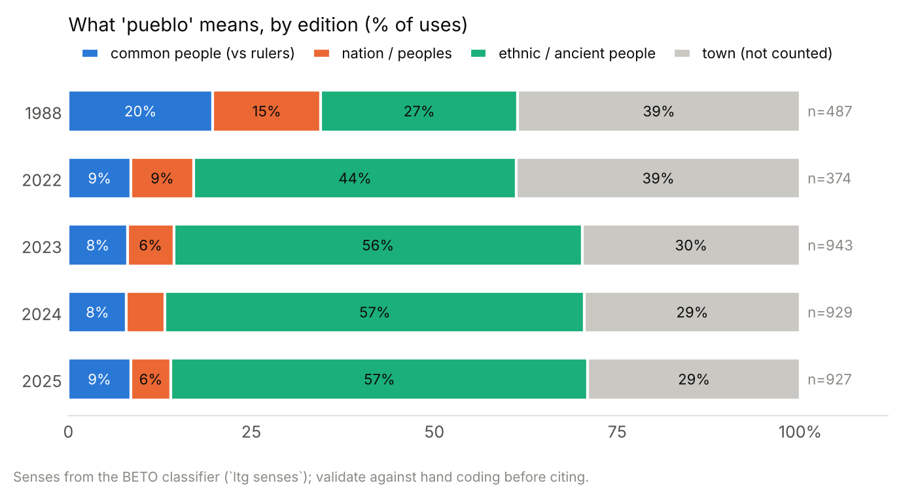
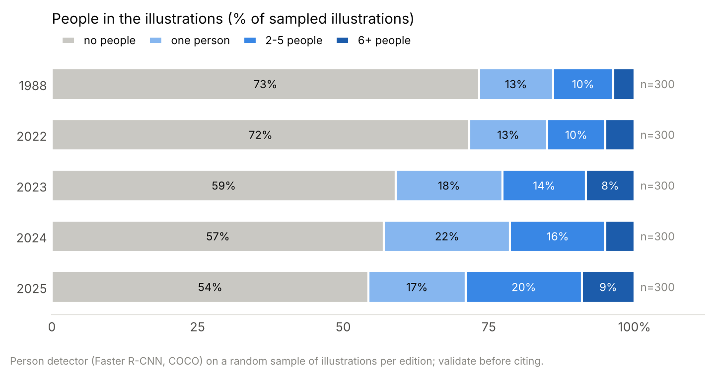

# Preliminary findings: 'the people' in the free textbooks

First full run, 2026-11-04. **Preliminary**: the *pueblo* sense classifier was
trained on examples coded by Claude, and none of the automatic measures has yet
been checked against human coding (`results/validation/`). Numbers are for the
national corpus of student books (2022 state books reported separately); 95%
intervals resample books. 2023-2025 reprint largely the same NEM titles, so
treat them as one period with revisions, not three samples.

Full tables: [`results/text/report.md`](results/text/report.md),
[`results/visual/report.md`](results/visual/report.md); figures in
[`results/figures/`](results/figures/).

## Corpus

| edition | books | pages | words | mean OCR confidence |
|---|---|---|---|---|
| 1988 generation | 26 | 4,902 | 0.50 M | 87.6 |
| 2022 (pre-NEM) | 42 (+31 state) | 6,847 | 1.00 M | 89.1 |
| 2023 (NEM) | 33 | 9,477 | 1.58 M | 90.5 |
| 2024 (NEM) | 36 | 9,810 | 1.60 M | 89.7 |
| 2025 (NEM) | 36 | 9,887 | 1.64 M | 90.0 |

204 books, 47,893 pages OCR'd, 81,632 illustrations cut out. The 2026-27
books were not downloaded (encrypted reader; see README).

## 1. Which people: from class and the common people to communities and *pueblos originarios*

Per 10,000 words:

| | 1988 | 2022 | NEM 2023-2025 |
|---|---|---|---|
| all people nouns | 51.6 [26.3, 77.1] | 39.3 [29.0, 50.0] | 60.1-62.8 |
| community (classroom uses removed) | 5.1 [2.8, 8.1] | 8.9 [6.3, 12.3] | 33.6-35.4 |
| workers / peasants | 9.3 [4.7, 14.4] | 2.3 [1.0, 4.4] | 1.9 |
| ordinary people / the poor (*gente*, *las masas*) | 10.5 [6.0, 16.1] | 2.0 [1.5, 2.6] | 1.9-2.0 |
| indigenous / ethnic | 7.2 [2.3, 13.1] | 7.4 [4.1, 12.2] | 9.7-9.9 |
| nation / *patria* | 4.2 [1.6, 7.2] | 2.7 [1.6, 4.5] | 2.6 |

- The class vocabulary of the 1988 books (*campesinos, obreros, trabajadores,
  artesanos*) and talk of ordinary *gente* fall by three quarters to four fifths
  by 2022 and stay there.
- NEM's rise in people-talk is almost entirely *comunidad*, **after** removing
  the 3,300-3,400 classroom uses per edition ("En asamblea, elaboren...",
  "En pequeñas comunidades, reúnan...") and ~1,000 school uses. Counted
  naively, community talk would be roughly twice as high.

## 2. What *pueblo* means: a singular people against rulers becomes plural, ethnic *pueblos*

| share of uses of *pueblo* | 1988 (n=487) | 2022 (n=374) | NEM (n≈930 per edition) |
|---|---|---|---|
| common people, against rulers or as the demos | 20% | 9% | 8-9% |
| nation / peoples of the world | 15% | 9% | 5-7% |
| ethnic, indigenous or ancient people | 27% | 44% | 56-57% |
| town | 39% | 39% | 29-30% |

Of people-sense uses, plural *pueblos* rises from 48% (1988) to 66% (2022) and
75% (NEM); the top modifier in NEM is *originario* (~175 per edition). The
1988 books' *el pueblo* is typically the governed set against rulers ("el
pueblo los obedecía ciegamente y carecía de derechos", "los macehualtin, el
resto del pueblo", "representantes elegidos por el pueblo"). NEM keeps a
smaller set of such uses, some explicitly anti-elite ("la democracia es el
gobierno del pueblo y no de una élite o de pugnas partidarias").

## 3. Relations: grievance and pluralism rise; unity markers stay rare

Per 10,000 words:

| | 1988 | 2022 | NEM |
|---|---|---|---|
| grievance (*discriminación, desigualdad, abuso, explotación, racismo*) | 1.6 [0.4, 3.2] | 4.2 [2.0, 6.9] | 6.6-7.7 |
| elites / antagonists | 3.1 [1.0, 5.3] | 1.2 [0.5, 2.2] | 1.8-2.2 |
| pluralism (*diverso, diversidad, diálogo, derechos humanos*) | 3.1 [1.9, 4.4] | 8.9 [6.9, 11.0] | 16.3-16.9 |
| unity / homogeneity markers | 0.5 | 0.2 | 0.4-0.6 |

Within sentences about the people, pluralism co-occurs in 1.2% (1988), 3.7%
(2022) and 5.9-6.6% (NEM); grievance in 1.3%, 2.1% and 2.3-3.1%. On these
measures NEM constructs a **plural, ethnically marked, aggrieved** people rather
than the unified *pueblo* of a populist ideal type; the antagonistic register
is concentrated in particular places (next point and the NEM history book
*Nuestros saberes: México, grandeza y diversidad*: "la explotación de los
pueblos originarios", "dominado por una minoría").

## 4. The 2025 reprint adds an explicitly political page

All 18 *Proyectos* books of 2025 (de aula, comunitarios, escolares; grades
1-6) carry a new page 10, absent in 2023 and 2024: "alinear la voluntad de los
integrantes afines y disidentes en favor de una agenda política cuyo objetivo
sea la lucha en beneficio de una comunidad", "La afrenta más profunda a este
sistema consumista es organizar colectivos democráticos y diversos; es decir,
demodiversos", "convencer al disidente". Keyness 2024 vs 2025 shows the same
vocabulary (*hegemonía, demodiverso, disidente, insurgencia, opresor,
individualista, agenda*). **Check the page images** for whom the page
addresses (its register suggests teachers or families) before interpreting it.

## 5. Agency: the people act less, and are possessors more (tentative)

People nouns as grammatical agents: 34.4% [31.8, 37.5] of mentions (1988),
14.5% [12.7, 16.1] (2022), 10.6-10.8% (NEM). For *pueblo*, the possessor role
("la cultura / los derechos de los pueblos originarios") rises from 34% to 43%
to 49%. Part of this is genre (NEM text is questions and activities, where the
parser also makes more errors): validate with `results/validation/role_sample.csv`
before citing.

## 6. Images

On a random sample of 300 illustrations per edition, the person detector finds
people in 26.7% [19.9, 32.6] (1988), 28.3% [21.2, 36.5] (2022) and
41.0-45.7% (NEM) of illustrations. Among those with people, crowds (6+) are
12-20% with no clear trend. Illustrations take a smaller share of NEM pages
(0.20 vs 0.35 of page area, similar counts per page). CLIP's labels (unvalidated)
suggest the 1988 people-images are more often protest, farming, collective
work and assembly scenes; NEM's more often school settings and festivals;
soldiers almost vanish (8.8% in 1988, 3.5% in 2022, 0-1.6% in NEM) and traditional dress returns
(11% -> 6% -> 12-16%). Treat the CLIP results as hypotheses for the
hand-coding sheet (`results/validation/visual_sample.csv`).

## What these numbers still need

1. **Hand-code the three samples** in `results/validation/` (543 sense items,
   349 role items, 276 images, stratified by period) and run
   `python -m ltg validate --kind sense|role|visual`. Replace or extend the
   Claude-coded seeds in `ltg/seeds/` with your own coding.
2. **Read the 2025 page 10** in the page images and decide how to treat it.
3. **Decide on 2026-27** (encrypted reader; images at an unlinked path).
4. **APSI**: translate `data/results/people_sentences_for_apsi.csv` (30,104
   people-talk sentences) and score them, as a second measure of
   people-centrism and anti-elitism.
5. Subject-matched comparison (social-content books only) and a
   leave-one-term-out check of the lexicon, as planned in RESEARCH_DESIGN.md.
