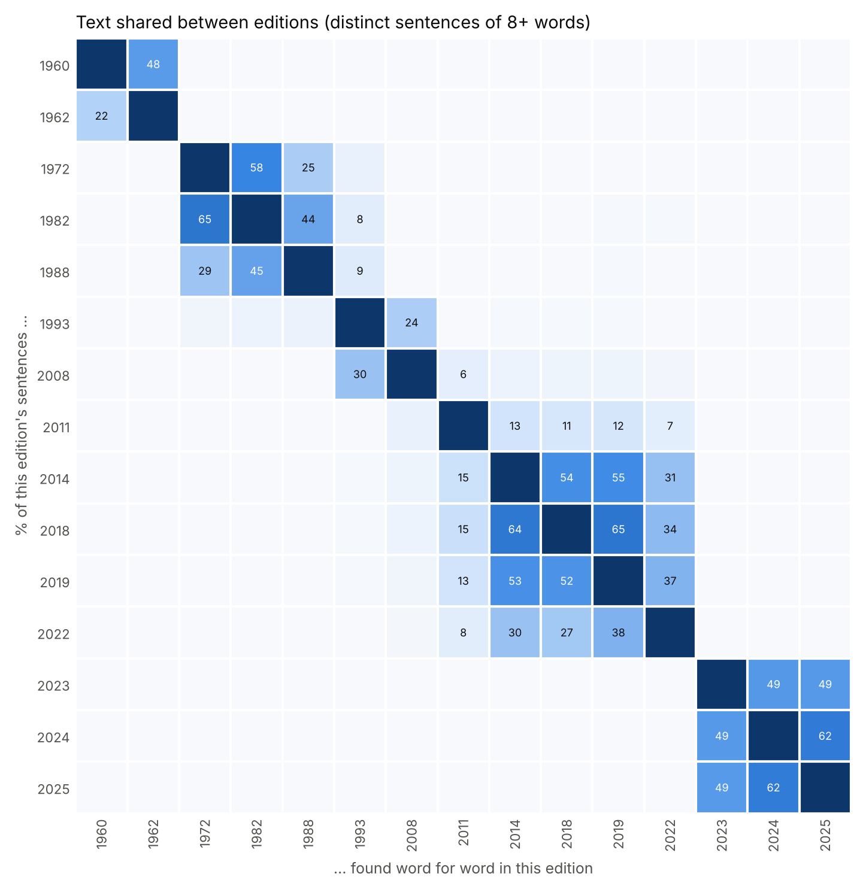

# Preliminary findings: 'the people' in Mexico's free textbooks, 1960-2025

Second full run, 2026-11-04: every generation of the historical archive (1960,
1962, 1972, 1982, 1988, 1993, 2008, 2011, 2014, 2018, 2019), the 2022 catalog
and the NEM books of 2023-2025. **Preliminary**: the *pueblo* sense classifier
was trained on examples coded by Claude, and no automatic measure has yet been
checked against human coding (`results/validation/`). National corpus of
student books only: teaching editions are excluded, and state-specific books
are left out of the comparison. Every rate has a 95% interval from resampling
books in [`results/text/report.md`](results/text/report.md); the early
generations, with few long books, have the widest intervals.

Full tables: [`results/text/report.md`](results/text/report.md),
[`results/visual/report.md`](results/visual/report.md); figures in
[`results/figures/`](results/figures/). The tables below give the range across
the editions of each era (one value where an era is one edition).

## Corpus

| edition | books | pages | words | mean OCR confidence |
|---|---|---|---|---|
| 1960 | 20 | 3,194 | 0.41 M | 87.3 |
| 1962 | 38 | 6,446 | 0.97 M | 88.5 |
| 1972 | 36 | 6,403 | 0.67 M | 87.8 |
| 1982 | 28 | 5,214 | 0.57 M | 88.3 |
| 1988 | 26 | 4,902 | 0.50 M | 87.6 |
| 1993 | 50 | 7,633 | 1.04 M | 86.2 |
| 2008 | 44 | 6,190 | 0.88 M | 86.7 |
| 2011 | 51 | 7,183 | 1.13 M | 87.2 |
| 2014 | 44 | 6,914 | 1.00 M | 89.4 |
| 2018 | 33 | 4,997 | 0.83 M | 89.6 |
| 2019 | 45 | 7,090 | 1.03 M | 89.5 |
| 2022 | 42 | 6,847 | 1.00 M | 89.1 |
| 2023 | 33 | 9,477 | 1.58 M | 90.5 |
| 2024 | 36 | 9,810 | 1.60 M | 89.7 |
| 2025 | 36 | 9,887 | 1.64 M | 90.0 |

562 national student books, 102,187 pages, 14.8 M words (116,952 pages and
187,951 illustrations including the state books). The 2026-27 books were not
downloaded (encrypted reader; see README).

## 0. How the generations relate: families of books and one clean break

Share of an edition's distinct sentences (8+ words) found word for word in
another edition (a lower bound on reuse):

- **1960 -> 1962**: 48% of the 1960 sentences recur in 1962.
- **1972 -> 1982 -> 1988 are one family**: 1982 shares 65% with 1972; 1988
  shares 45% with 1982 and 29% with 1972. The 1988 generation continues the
  1970s-80s books rather than replacing them.
- **1993 and 2011 are rewrites**: at most 5% of their sentences occur in any
  earlier edition. 2008 carries over part of 1993 (30% of its sentences).
- **2014, 2018, 2019 and 2022 are one family** (52-65% shared among the first
  three; 27-38% with 2022).
- **NEM (2023) shares nothing (0%) with any earlier edition.** 2023-2025 share
  49-62% with each other: reprints with substantial revision.

Read every trend below against these families: within a family, differences
are revision; between families, they are rewrites.

## 1. Who the people are

| per 10,000 words | 1960-62 | 1972-88 | 1993 | 2008-22 | NEM 2023-25 |
|---|---|---|---|---|---|
| all people nouns | 42.2-45.0 | 41.1-51.5 | 37.5 | 35.5-43.1 | 60.1-62.7 |
| *pueblo* (people senses) | 4.9-6.5 | 4.9-6.0 | 2.9 | 2.2-2.8 | 4.0-4.2 |
| nation / *patria* | 8.4-9.6 | 2.9-4.2 | 3.7 | 2.7-6.1 | 2.5-2.6 |
| citizens / society | 6.9-9.2 | 6.7-9.3 | 13.2 | 14.4-19.5 | 8.0-8.8 |
| community (classroom uses removed) | 1.1-1.5 | 3.3-5.1 | 3.5 | 4.3-8.9 | 33.6-35.4 |
| workers / peasants | 4.7-4.9 | 8.2-10.2 | 2.7 | 2.3-3.1 | 1.9 |
| ordinary people (mostly *gente*) | 2.0-2.1 | 9.0-10.5 | 4.4 | 2.0-3.4 | 1.9-2.0 |
| indigenous / ethnic | 11.4-14.3 | 4.7-7.5 | 7.2 | 5.2-7.5 | 9.7-10.0 |

Read as five constructions of the people, one per family:

- **1960s: the nation.** *Patria* and *nación* peak (a civic pledge, "Mi
  patria es México... Así honraré a mi familia, a la sociedad en que vivo, a mi
  país y a la humanidad", recurs in 22 of the 38 books of 1962 and 7 of the 20
  of 1960, but accounts for a small part of the count). The ethnic vocabulary is ancient history: *aztecas*, *indios*,
  *toltecas*.
- **1972-88: the working, ordinary people.** *Campesinos, obreros,
  trabajadores, artesanos* and *gente* peak. Part of it is everyday register
  (word problems, stories: "Un campesino tiene 6 caballos"), part labour and
  social history ("hacer algo para que los obreros tuvieran un trato más
  justo").
- **1993-2022: the citizenry.** *Ciudadanos, sociedad, población* rise to
  their highest, with democratic institutions (2008-2022).
- **NEM: the community.** *Comunidad* jumps to ~34 per 10,000 words *after*
  removing 3,300-3,400 classroom uses per edition ("En asamblea,
  elaboren...") and ~1,000 school uses; nation, citizens and class fall to
  their lowest or near it. The ethnic vocabulary is now *pueblos originarios*.

## 2. What *pueblo* means

| % of uses of *pueblo* | 1960-62 | 1972-88 | 1993 | 2008-22 | NEM 2023-25 |
|---|---|---|---|---|---|
| common people, against rulers / the demos | 23-29 | 17-21 | 9 | 9-16 | 8-9 |
| nation / peoples of the world | 16-20 | 14-15 | 9 | 10-16 | 7-8 |
| ethnic, indigenous or ancient people | 23-33 | 21-26 | 36 | 25-41 | 53-54 |
| town | 24-32 | 39-44 | 46 | 32-44 | 31 |
| plural *pueblos*, % of people-sense uses | 27-42 | 46-54 | 61 | 56-67 | 76 |

The singular, political *el pueblo* belongs to the early books. In the 1960s
it is above all the **electoral and sovereign demos** ("el gobierno es elegido
por el pueblo por medio del voto", "reconoció la soberanía del pueblo,
ejercida por medio del voto", "la Constitución... debe ser obedecida tanto por
el pueblo como por el gobierno"); in 1972-88 more often **the governed against
rulers** in world history ("el pueblo vivía pobremente y sin derechos", "si
era malo el pueblo sufría y no podía protestar"). From 1993 the word turns
plural and ethnic, and NEM completes the move: over half of all uses are
*pueblos originarios / indígenas*, and plural *pueblos* is three quarters of
people-sense uses (27% in 1960). Classifier: 451 coded examples, 5-fold CV
accuracy 0.88 (people vs town 0.95); coding rules in `ltg/seeds/CODING.md`.

## 3. Relations: who the people stand with and against

| per 10,000 words | 1960-62 | 1972-88 | 1993 | 2008-22 | NEM 2023-25 |
|---|---|---|---|---|---|
| grievance (*discriminación, desigualdad, explotación...*) | 1.9-2.4 | 1.6-1.8 | 1.5 | 2.9-5.0 | 6.6-7.7 |
| elites / antagonists | 3.2-3.4 | 2.7-3.1 | 1.3 | 1.0-1.8 | 1.8-2.2 |
| pluralism / diversity | 1.8-2.7 | 2.4-3.1 | 4.1 | 8.2-10.7 | 16.3-16.9 |
| unity markers | 0.8 | 0.4-0.5 | 0.2 | 0.2-0.4 | 0.4-0.6 |
| democratic institutions | 12.0-13.3 | 5.9-7.6 | 7.4 | 11.5-17.1 | 9.1-9.3 |

| % of people-talk sentences with | 1960-62 | 1972-88 | 1993 | 2008-22 | NEM 2023-25 |
|---|---|---|---|---|---|
| an elite / antagonist term | 2.7-3.5 | 2.2-2.5 | 1.1 | 0.8-1.4 | 1.3-1.6 |
| a grievance term | 2.0-2.2 | 1.3-1.5 | 1.3 | 1.9-2.3 | 2.3-3.1 |
| a pluralism term | 0.6-1.1 | 1.0-1.2 | 2.0 | 3.3-4.8 | 6.0-6.6 |
| a unity marker | 1.8-2.0 | 0.9-1.1 | 0.5 | 0.2-0.9 | 0.2-0.3 |
| an institution | 6.7-9.2 | 3.8-5.1 | 3.0 | 6.2-9.4 | 3.7-3.9 |
| *nosotros / nuestro* | 9.8-10.4 | 2.7-3.0 | 4.3 | 3.2-7.1 | 6.1-6.3 |

- Antagonist vocabulary was **highest in the 1960s-80s** and fell after 1993;
  NEM raises it only slightly. What NEM raises is **grievance** (discrimination,
  inequality, abuse) and, most of all, **pluralism**, both on a trend that
  starts in 2008.
- **Unity** and the inclusive ***nosotros*** were strongest in the 1960s; NEM
  brings *nosotros* back, not unity.
- On these measures NEM constructs a **plural, ethnically marked, aggrieved
  people organised in communities**, closer to a multicultural than to a
  unitary populist *pueblo*. The antagonistic register is concentrated in
  particular places: the NEM history book *Nuestros saberes: México, grandeza y
  diversidad* ("la explotación de los pueblos originarios", "dominado por una
  minoría") and the 2025 page below.

## 4. The 2025 reprint adds an explicitly political page

All 18 *Proyectos* books of 2025 (de aula, comunitarios, escolares; grades
1-6) carry a new page 10, absent in 2023 and 2024: "alinear la voluntad de los
integrantes afines y disidentes en favor de una agenda política cuyo objetivo
sea la lucha en beneficio de una comunidad", "La afrenta más profunda a este
sistema consumista es organizar colectivos democráticos y diversos; es decir,
demodiversos", "convencer al disidente". Keyness 2024 vs 2025 shows the same
vocabulary (*hegemonía, demodiverso, disidente, insurgencia, opresor*). **Check
the page images** for whom the page addresses before interpreting it.

## 5. Agency (tentative)

People nouns as grammatical agents: 21-22% of mentions in the 1960s, **34-35%
in 1972-88**, 23% in 1993, 14-19% in 2008-22 and **11% in NEM**. The 1972-88
books narrate what peoples and classes did; NEM text is questions and
activities, where the parser also errs more. Validate with
`results/validation/role_sample.csv` before citing.

## 6. Images

| | 1960-62 | 1972-88 | 1993 | 2008-22 | NEM 2023-25 |
|---|---|---|---|---|---|
| illustrations with people (detector), % | 18-20 | 17-27 | 22 | 20-29 | 41-46 |
| share of page area that is illustration | 0.15-0.16 | 0.32-0.36 | 0.47 | 0.36-0.42 | 0.20 |
| CLIP: farming scenes, % of people-images | 20 | 14-25 | 18 | 4-10 | 5-7 |
| CLIP: protest scenes, % of people-images | 16-20 | 9-18 | 8 | 4-11 | 7-11 |
| CLIP: school setting, % of people-images | 15-28 | 14-23 | 12 | 23-46 | 50-52 |

On a random sample of 300 illustrations per edition, people appear in about a
fifth to a quarter of illustrations from 1960 to 2022 and in **41-46% in NEM**
(95% intervals around 33-52%, against 12-37% for every earlier edition). The
CLIP labels (unvalidated; 55-140 people-images per edition) suggest people at
work in the fields and in protests in the early books, and at school in the
recent ones. Treat them as hypotheses for the hand-coding sheet.

## What these numbers still need

1. **Hand-code the samples** in `results/validation/` (660 sense items, 384
   role items, 344 images, stratified by six eras) and run
   `python -m ltg validate --kind sense|role|visual`. Replace or extend the
   Claude-coded seeds in `ltg/seeds/` with your own coding.
2. **Read the 2025 page 10** in the page images.
3. **Decide on 2026-27** (encrypted reader; images at an unlinked path).
4. **APSI**: translate `data/results/people_sentences_for_apsi.csv` (58,430
   people-talk sentences) and score them as a second measure of
   people-centrism and anti-elitism.
5. Subject-matched comparison (social-content books only), a leave-one-term-out
   check of the lexicon, and the state books (1993, 2014, 2019, 2022) as a
   separate corpus.
